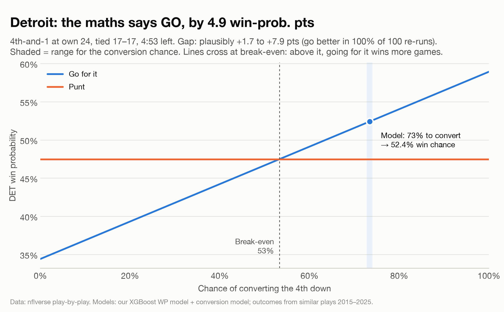
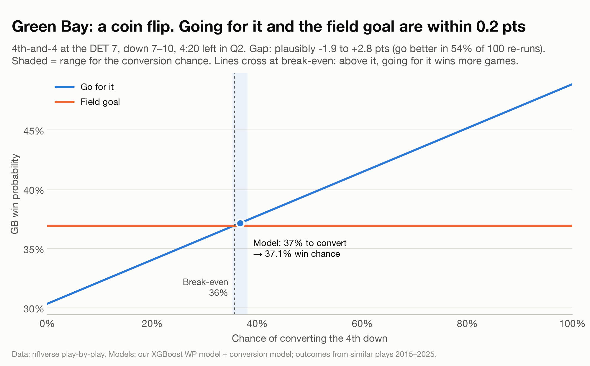

# Go for it or take the points?

**Two failed 4th downs from Lions 20, Packers 17 (25 Oct 2026), judged on what was known *before* the snap.**

| Play | Call | Win prob. if go | If kick | Verdict |
|---|---|---|---|---|
| **DET** 4th-and-1, own 24, tied 17–17, 4:53 left | Went for it (stuffed) | 52.4% | 47.5% (punt) | **GO**, +4.9 pts (plausibly +1.7 to +7.9) |
| **GB** 4th-and-4 at DET 7, down 7–10, Q2 | Went for it (no gain) | 37.1% | 36.9% (25-yd FG) | **Coin flip**, +0.2 pts (plausibly −1.9 to +2.8) |

Detroit needed to convert 53% of the time to break even; the model gives them 73%. Green Bay needed 36% and had about 37%.

<p align="center"> </p>

---

## How it works

Every 4th down comes down to one comparison:

```
WP(go)   = P(convert) × WP(if convert) + (1 − P(convert)) × WP(if fail)
WP(punt) = WP(after a typical punt)
WP(FG)   = P(make) × WP(if made) + (1 − P(make)) × WP(if missed)
```

1. **Win probability (WP) model:** a rebuild of nflverse's public model.
   - Method: XGBoost, using the same 12 inputs, settings and forced directions (monotone constraints).
   - Testing: leave-one-season-out, so each season is predicted by a model that never saw it. Log loss 0.446 (nflverse: 0.443), well calibrated in every quarter.
   - Baseline: a logistic regression on the same inputs scores 0.457, with roughly double the calibration error.
   - Adding season-to-date team strength or the over/under made the model *worse*, because the betting spread already carries that information.
2. **Conversion model:** a logistic regression on every 3rd and 4th down since 2000, using log(distance), 4th-down and goal-line flags, and each team's season-to-date rushing efficiency.
   - Trained 2000–2024, validated on 2025, tested on 2026.
   - Explosive-run rate was tested and dropped: it adds nothing once rushing efficiency is in the model.
3. **Outcomes:** real results of similar plays from 2015–2025 (yards gained, clock used, returns, penalties, scores), shifted into this game's field position, score, clock, timeouts and spread, then scored by the WP model.
4. **Uncertainty:** 100 bootstrap re-runs, each refitting both models on resampled games and resampling the outcome pools.

## Background findings (2015–2025 unless noted)

| | |
|---|---|
| Go rate on 4th-and-1 to 3 (normal situations) | 19% (1999–2017) → 53% (2025) |
| Conversion by distance | 1–3 yds 63% · 4–9 yds 44% · 10+ yds 24% |
| 4th-and-1 by play type | QB sneak 83% · other runs 65% · passes 58% |
| 50/50 field-goal distance | 52 yds (1999–2005) → 59 yds |
| Break-even on 4th-and-short | Go almost everywhere (need 37–49%, convert ~62%) |
| Coach aggressiveness vs expected (2025–26) | Campbell +6.4 pts (3rd) · LaFleur +4.1 (8th) |

## Reproduce

```bash
python3.12 -m venv .venv && .venv/bin/pip install -r requirements.txt   # macOS: brew install libomp
.venv/bin/python 01_pull.py         # download nflverse play-by-play 1999–2026 (~1 min)
.venv/bin/python 02_clean.py        # build data/clean/*.parquet (~2 s)

# Background questions -> figures/ + printed results
for f in analysis/q*.py; do .venv/bin/python "$f"; done

# Win-probability models
.venv/bin/python analysis/wp_baseline_nflverse.py   # benchmark nflverse's own model
.venv/bin/python analysis/wp_replicate.py           # XGBoost replica (~1 min), saves models/
.venv/bin/python analysis/wp_logistic.py            # logistic baseline
.venv/bin/python analysis/wp_variants.py            # feature tests (~3 min)

# Conversion model tests + the decision
.venv/bin/python analysis/explosive_runs.py
.venv/bin/python analysis/case_a_lafleur.py
.venv/bin/python analysis/decision.py 100           # bootstrap (~7 min); 0 = point estimates only
```

**Data snapshot:** nflverse play-by-play pulled 26 Oct 2026 (through 2026 week 7). nflverse occasionally corrects past games, so a later pull may shift numbers slightly.

## Layout

```
01_pull.py, 02_clean.py     data download + cleaning (data/ is git-ignored)
analysis/                   one script per question / model
  common.py, wp_common.py   shared helpers (loading, buckets, chart style, scoring, LOSO loop)
models/                     final XGBoost WP models (nflverse replica, with and without spread)
figures/                    all charts
```

## Caveats

- **Selection bias:** conversion rates come from teams that *chose* to go, so they may run slightly high.
- **What the models don't see:** injuries, matchups, and film study. Team strength enters only through the betting spread and rushing efficiency.
- **Small samples:** Green Bay's outcome pools are small (52 similar conversions, 29 missed short FGs), so its range is wide.

## Credits

Data: [nflverse](https://github.com/nflverse) play-by-play via [nflreadpy](https://github.com/nflverse/nflreadpy). WP model design: [nflfastR](https://github.com/nflverse/nflfastR) ([write-up](https://www.opensourcefootball.com/posts/2020-09-28-nflfastr-ep-wp-and-cp-models/)).
